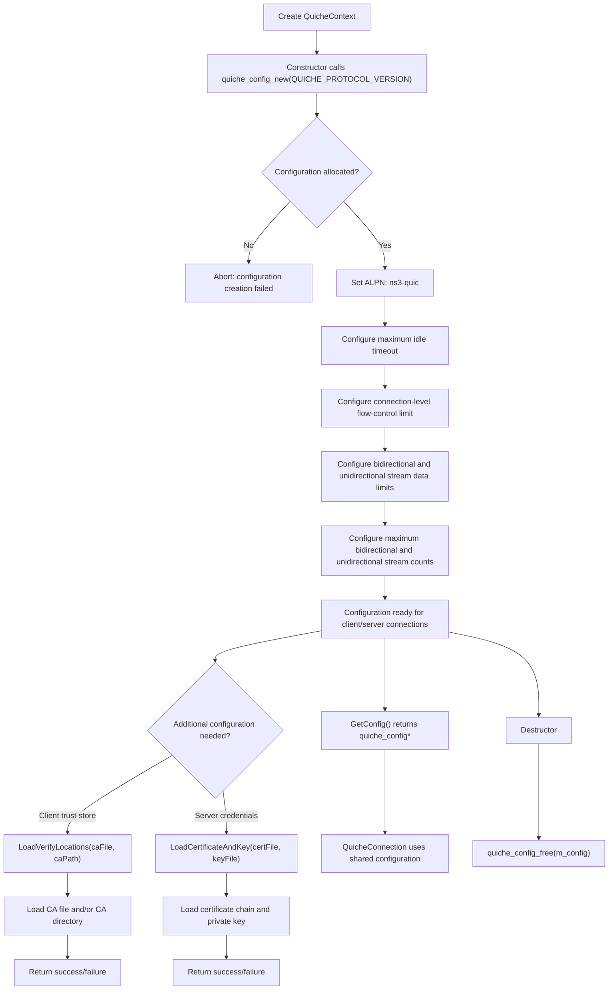
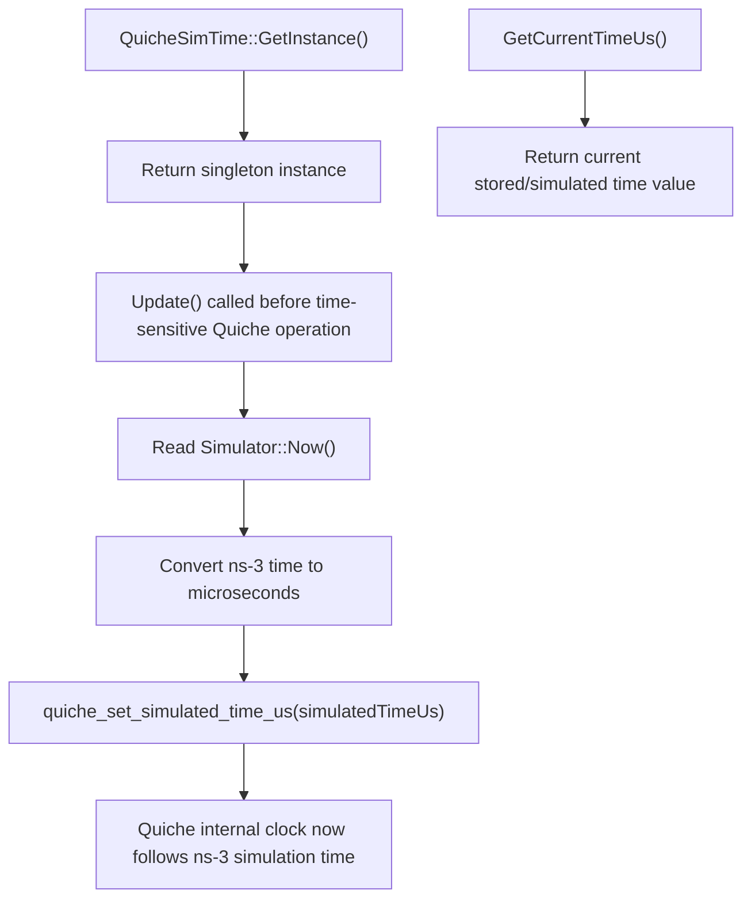
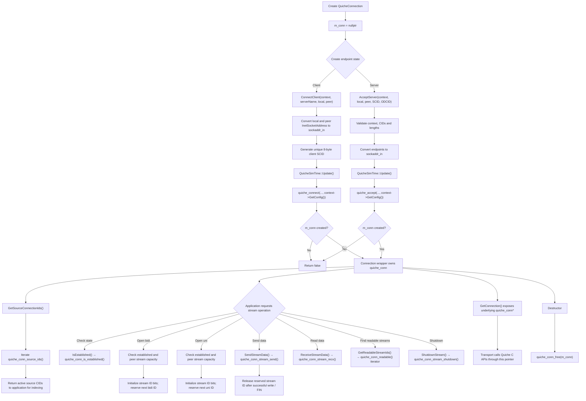
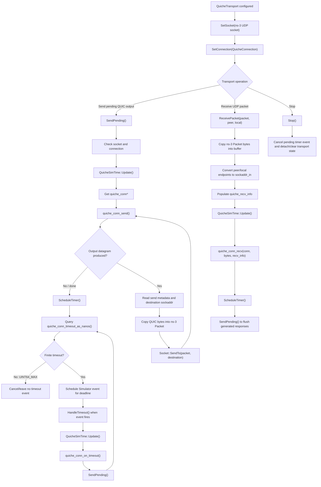
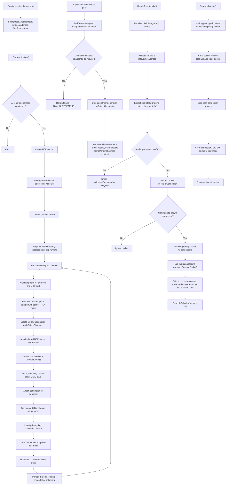
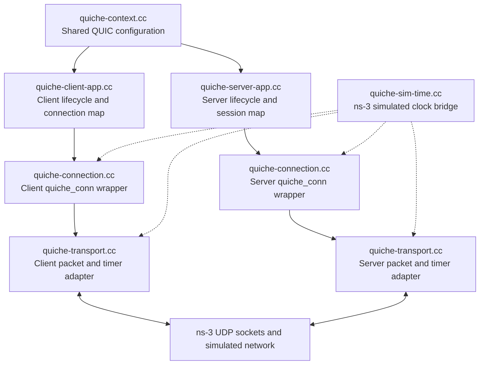

# Quiche–ns-3: File-wise Workflow Flowcharts

These flowcharts are based on the uploaded `quiche-ns3-main.zip` source tree. They describe the control flow in each implementation file, rather than a generic QUIC architecture.

## 1. `quiche-context.cc` — shared QUIC configuration

**Main role:** owns `quiche_config*` and applies common QUIC settings. The client and server create a context; the server additionally loads its certificate and private key. `LoadVerifyLocations()` is available for configuring client-side trust roots.

## 2. `quiche-sim-time.cc` — ns-3 clock bridge

**Main role:** keeps Quiche's time-dependent protocol calculations aligned with the ns-3 simulation clock. The bridge is used by connection setup and transport receive/send/timeout processing.

## 3. `quiche-connection.cc` — wrapper around one `quiche_conn`

**Main role:** owns exactly one Quiche connection and wraps the C API for connect/accept, connection state, source-CID retrieval, stream IDs, stream send/receive, and stream shutdown. It does not itself send UDP packets.

## 4. `quiche-transport.cc` — packet adapter and per-connection timer

**Main role:** converts between ns-3 `Packet`/socket-address objects and Quiche's byte-buffer/`sockaddr` interface. It sends all generated QUIC datagrams through the ns-3 UDP socket and schedules Quiche deadlines on the ns-3 event scheduler.

## 5. `quiche-client-app.cc` — client lifecycle, connection map and packet dispatch

**Main role:** manages client-side configuration and lifecycle, creates one connection record per configured remote, maintains endpoint-pair and CID indexes, exposes stream APIs, and dispatches received UDP packets to the matching transport.

## 6. `quiche-server-app.cc` — listening, session creation, CID demultiplexing and cleanup

```mermaid
flowchart TD
    A["Configure local IPv4 endpoint and certificate/key paths"] --> B["StartApplication()"]
    B --> C{"Specific local IPv4 and nonzero port configured?"}
    C -->|No| X["Abort"]
    C -->|Yes| D{"Certificate and key paths configured?"}
    D -->|No| X
    D -->|Yes| E["Create QuicheContext"]
    E --> F["LoadCertificateAndKey()"]
    F --> G{"Credentials loaded?"}
    G -->|No| X
    G -->|Yes| H["Create UDP socket and bind local endpoint"]
    H --> I["Register HandleRead() callback"]
    I --> J["Schedule periodic closed-session cleanup"]
    J --> K["Server listens for UDP datagrams"]

    K --> L["HandleRead(): receive datagram and source peer"]
    L --> M["Parse QUIC header and extract DCID"]
    M --> N{"Header valid?"}
    N -->|No| L
    N -->|Yes| O["Lookup DCID in m_cidToSession"]
    O --> P{"Known CID?"}
    P -->|Yes| Q["Resolve session by primary CID"]
    Q --> R{"Session exists and source endpoint pair matches?"}
    R -->|No| S["Drop packet"]
    R -->|Yes| V["Dispatch to session transport"]

    P -->|No| T["Check minimum Initial size; parse header, type and version"]
    T --> U{"Supported-version Initial?"}
    U -->|No| S
    U -->|Yes| U1{"Session already exists for endpoint pair?"}
    U1 -->|Yes| S
    U1 -->|No| U2["CreateSession(peer, local, packet)"]
    U2 --> U3["Parse client SCID and original DCID"]
    U3 --> U4["Generate server SCID"]
    U4 --> U5["Create QuicheConnection; call AcceptServer()"]
    U5 --> U6{"quiche_accept() successful?"}
    U6 -->|No| S
    U6 -->|Yes| U7["Create QuicheTransport; attach server UDP socket and connection"]
    U7 --> U8["Read server source CIDs; select primary CID"]
    U8 --> U9["Insert session record and endpoint-pair index"]
    U9 --> U10["Refresh CID index, including client's original DCID"]
    U10 --> V

    V --> W["QuicheTransport::ReceivePacket(packet, peer, local)"]
    W --> Y["Refresh CID index after Quiche processes packet"]
    Y --> Z{"Connection closed or timed out?"}
    Z -->|Yes| ZA["RemoveSession(primary CID)"]
    Z -->|No| K

    ZB["Periodic CleanupClosedSessions()"] --> ZC["Scan all sessions"]
    ZC --> ZD{"Connection null, closed or timed out?"}
    ZD -->|Yes| ZE["Collect primary CID for removal"]
    ZD -->|No| ZF["Keep session"]
    ZE --> ZA
    ZF --> ZG["Schedule next cleanup after 1 second"]
    ZA --> ZG
    ZG --> ZB

    ZH["Server application stream API"] --> ZI["FindSession(peer) via endpoint-pair index"]
    ZI --> ZJ{"Session / established connection available?"}
    ZJ -->|No| ZK["Return failure"]
    ZJ -->|Yes| ZL["Delegate stream operation to QuicheConnection"]
    ZL --> ZM["SendPending() after send, shutdown or receive-credit release where required"]

    ZN["StopApplication()"] --> ZO["Cancel cleanup and handshake polling events"]
    ZO --> ZP["Clear callback and close UDP socket"]
    ZP --> ZQ["Stop each session transport"]
    ZQ --> ZR["Clear session, CID and endpoint-pair maps; release context"]
```

**Main role:** listens for QUIC traffic, creates a session only from a supported-version Initial packet with an unknown DCID, maps active CIDs to sessions, dispatches packets, exposes server-side stream operations, and periodically removes closed or timed-out sessions.

## How the six files work together

## Important reading order

1. `quiche-context.cc` — understand how Quiche is configured.
2. `quiche-connection.cc` — understand the C API wrapper and stream operations.
3. `quiche-sim-time.cc` — understand the simulator-clock bridge.
4. `quiche-transport.cc` — understand packet conversion and timer scheduling.
5. `quiche-client-app.cc` — follow client startup, Initial transmission and receive dispatch.
6. `quiche-server-app.cc` — follow Initial validation, session creation, CID lookup and cleanup.

## Source-grounding notes

- The diagrams describe the uploaded source snapshot. They do not assume features that are not implemented in these files.
- The client and server use IPv4 `InetSocketAddress` / `sockaddr_in` conversion in this implementation.
- Server packet dispatch checks that the peer endpoint pair matches the session's original pair; this constrains connection migration.
- `quiche_connect()` and `quiche_accept()` create endpoint state; they do not by themselves mean the TLS handshake has completed. The wrapper checks `quiche_conn_is_established()`.
- The server's periodic cleanup is scheduled at one-second intervals.
- `quiche-transport.cc` owns the ns-3 timeout event; Quiche supplies the timeout deadline and processes it when `quiche_conn_on_timeout()` is called.
